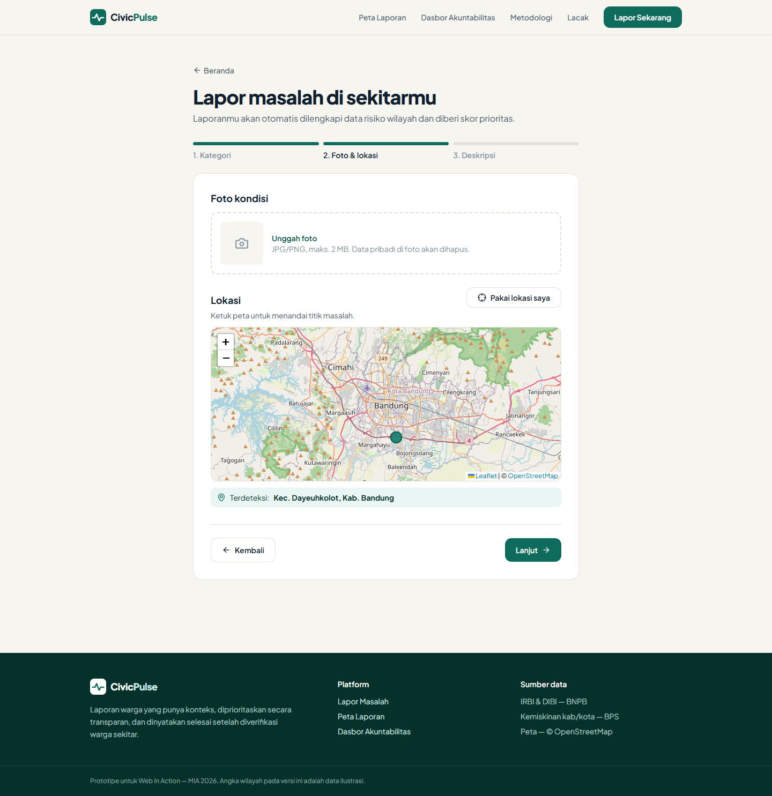
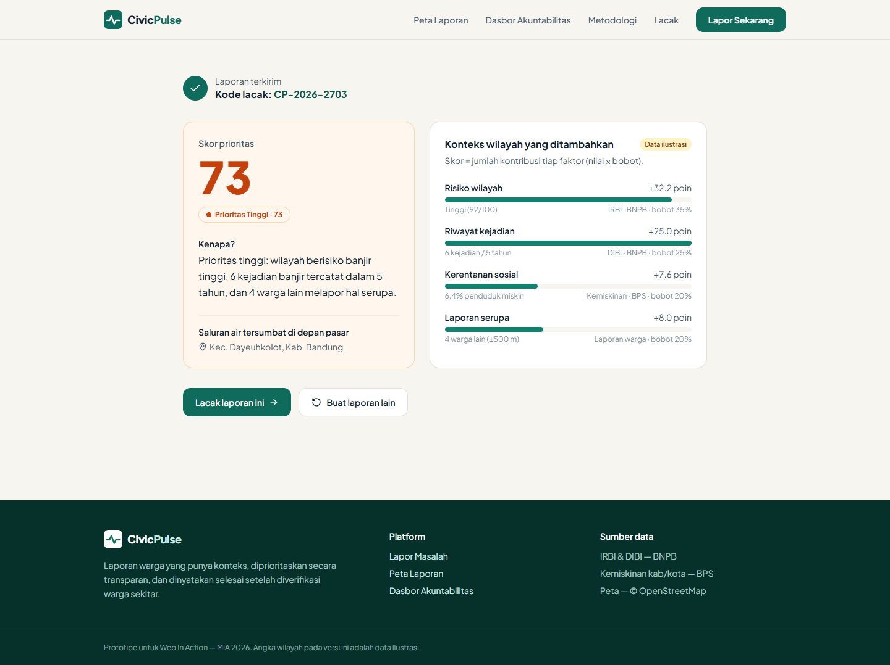
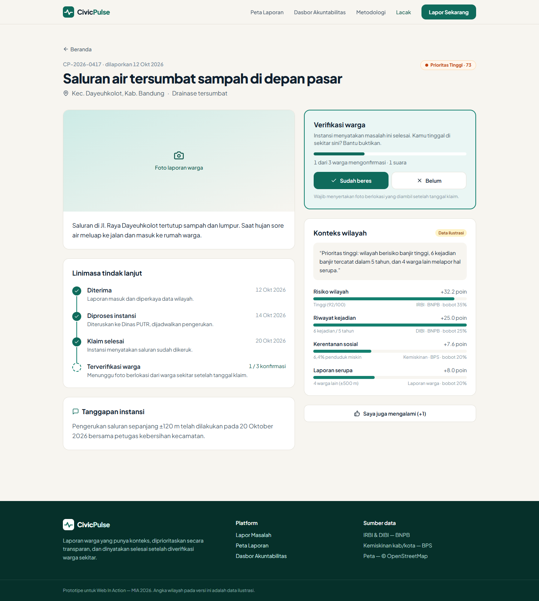
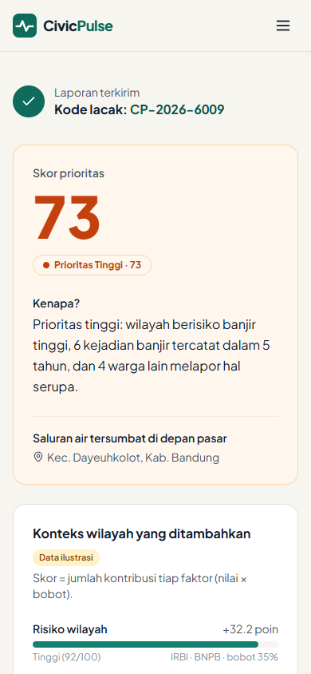

<div align="center">

# 🛰️ CivicPulse — Lapor Berkonteks

**Setiap laporan warga punya konteks, prioritas yang bisa dijelaskan, dan bukti penyelesaian dari warga sendiri.**

Web In Action — MIA 2026 · Tema *Designing Digital Futures — Powering Public Transparency*
Subtema **Civic Reporting & Accountability**, didukung **Data-Driven Decision Support**


</div>

---

## 📌 Masalah

Laporan warga tentang jalan rusak, banjir, atau drainase tersumbat sampai ke instansi **tanpa konteks**. Bagi petugas, semua laporan terlihat sama pentingnya.

| # | Masalah | Dampak |
| :-: | :-- | :-- |
| 1 | Laporan masuk tanpa konteks wilayah | Petugas tidak bisa membedakan mana yang paling berisiko |
| 2 | Yang diproses duluan adalah yang paling ramai atau vokal | Prioritas mengikuti popularitas, bukan kebutuhan |
| 3 | Wilayah rawan dan miskin jarang melapor | Wilayah yang paling membutuhkan justru terabaikan |
| 4 | Status "selesai" cukup diklaim instansi | Warga tidak bisa memastikan masalah benar-benar beres |

## 💡 Solusi: Alur Lapor Berkonteks

```
 Warga lapor        Diperkaya data publik     Skor prioritas + alasan     Tindak lanjut     Verifikasi warga
 (foto + lokasi) →  IRBI · DIBI · BPS      →  0–100, bisa dijelaskan   →  instansi      →  ≥ 3 warga sekitar  →  ✅ SELESAI
```

**Contoh:** warga melapor *"saluran air tersumbat"* dengan foto dan titik lokasi. CivicPulse otomatis menambahkan indeks risiko banjir wilayah (IRBI), jumlah kejadian banjir 5 tahun terakhir (DIBI), dan persentase penduduk miskin (BPS), lalu menghasilkan:

> **Prioritas Tinggi — 82/100**
> *"Wilayah berisiko banjir tinggi, 3 kejadian banjir tercatat dalam 5 tahun, dan 4 warga lain melaporkan hal serupa."*

### Apa yang membuat CivicPulse berbeda

- 🧭 **Konteks otomatis.** Warga tidak perlu mengisi data tambahan. Lokasi laporan langsung dicocokkan dengan data publik resmi.
- 🔍 **Skor transparan, bukan kotak hitam.** Rumus dipublikasikan, dan setiap skor disertai kalimat alasan serta rincian kontribusi tiap faktor.
- ⚖️ **Adil bagi wilayah yang jarang bersuara.** Faktor kerentanan sosial membuat wilayah miskin tetap naik prioritasnya, tidak kalah oleh wilayah yang paling ramai melapor.
- ✅ **Selesai = diverifikasi warga.** Status baru "Terverifikasi Selesai" setelah warga sekitar mengonfirmasi lewat foto berlokasi. Jika tidak, laporan dibuka ulang.

## 🖼️ Tampilan

| Form Lapor (langkah 2: foto & lokasi) | Hasil skor prioritas |
| :-: | :-: |
|  |  |

| Detail & lacak laporan | Tampilan mobile |
| :-: | :-: |
|  |  |

## ✨ Fitur

| Fitur | Penjelasan | Status |
| :-- | :-- | :-: |
| **Lapor Cepat** | Form 3 langkah (kategori → foto & lokasi di peta → deskripsi), mobile-first, deteksi kecamatan otomatis | ✅ |
| **Pengayaan Konteks** | Lokasi dicocokkan ke wilayah, ditempeli data risiko, riwayat kejadian, dan kemiskinan | ✅ (data ilustrasi) |
| **Skor Prioritas yang Bisa Dijelaskan** | Skor 0–100, kalimat alasan otomatis, rincian kontribusi tiap faktor | ✅ |
| **Pelacakan Tindak Lanjut** | Linimasa publik: Diterima → Diproses → Klaim Selesai → Terverifikasi / Dibuka Ulang | ✅ |
| **Verifikasi Warga & +1** | Tombol "Saya juga mengalami" dan verifikasi penyelesaian oleh warga sekitar | ✅ (UI) |
| **Tanggapan Instansi** | Hak jawab instansi ditampilkan publik di halaman laporan | ✅ (UI) |
| **Peta Laporan** | Sebaran laporan, warna sesuai tingkat prioritas, filter kategori/status/wilayah | 🔜 |
| **Dasbor Akuntabilitas** | Peta kesenjangan: risiko tinggi × laporan menumpuk × lambat ditangani | 🔜 |
| **Panel Instansi** | Antrean laporan diurutkan skor, ubah status, unggah bukti | 🔜 |
| **Anti-spam & Privasi** | Login tautan email, batas laporan harian, EXIF sensitif dihapus, tanpa NIK | 🔜 |

## 🧮 Rumus Skor Prioritas

```
Skor = 35% × Risiko wilayah      (IRBI, dinormalisasi 0–100, sesuai jenis bahaya kategori)
     + 25% × Riwayat kejadian    (jumlah kejadian DIBI 5 tahun terakhir)
     + 20% × Kerentanan sosial   (persentase penduduk miskin, BPS)
     + 20% × Laporan serupa      (pelapor unik dalam radius ±500 m / 30 hari, maks. 10)

Tinggi ≥ 70 · Sedang 40–69 · Rendah < 40
```

Kalimat alasan dibentuk otomatis dari 2–3 faktor dengan kontribusi terbesar. Implementasi: [`civicpulse/src/lib/priority.js`](civicpulse/src/lib/priority.js).

## 📊 Sumber Data Publik

| Data | Sumber | Cakupan | Dipakai untuk |
| :-- | :-- | :-- | :-- |
| Indeks Risiko Bencana Indonesia (IRBI) | BNPB | Per kabupaten/kota, 2015–2022 | Faktor risiko wilayah |
| Data dan Informasi Bencana Indonesia (DIBI) | BNPB | Kejadian bencana 1815–2021 | Faktor riwayat kejadian |
| Persentase penduduk miskin | BPS | Per kabupaten/kota (rilis 28 Nov 2025) | Faktor kerentanan sosial |
| Alokasi anggaran daerah | DJPK Kemenkeu | Tahun terbatas | Pembanding (pengembangan lanjut) |

> ⚠️ Pada versi First Draft ini, angka wilayah masih **data ilustrasi** untuk 8 kecamatan di Bandung Raya. Impor dataset asli IRBI, DIBI, dan BPS dijadwalkan sebelum Final Submission.

## 🎯 Kaitan dengan Subtema

| Unsur subtema | Wujud di CivicPulse |
| :-- | :-- |
| Platform pelaporan masyarakat | Lapor Cepat, +1 laporan serupa |
| Sistem verifikasi | Verifikasi warga berbasis foto berlokasi sebelum status selesai |
| Tindak lanjut | Linimasa status publik, panel instansi, hak jawab |
| Partisipasi warga dalam pengawasan | Dasbor akuntabilitas publik dan peta kesenjangan |
| Data-driven decision support | Skor prioritas berbasis IRBI, DIBI, dan BPS untuk mengurutkan antrean instansi |

## 🛠️ Tech Stack

- **React 18 + Vite 5**: frontend dan build tool
- **Tailwind CSS 3**: styling responsif, mobile-first
- **React Router 6**: navigasi antarhalaman
- **Leaflet + React Leaflet + OpenStreetMap**: peta pemilihan lokasi
- **Lucide React**: ikon

## 🚀 Cara Menjalankan

Prasyarat: **Node.js 18+**.

```bash
git clone https://github.com/PehPulo/civicpulse.git
cd civicpulse/civicpulse
npm install
npm run dev
# buka http://localhost:5173
```

Build produksi: `npm run build`, lalu `npm run preview`.

**Demo cepat:**

| URL | Isi |
| :-- | :-- |
| `/` | Landing page |
| `/lapor` | Form lapor 3 langkah |
| `/lapor?contoh=hasil` | Langsung ke hasil skor prioritas |
| `/laporan/CP-2026-0417` | Contoh pelacakan laporan |

## 📁 Struktur Repository

```
.
├── civicpulse/              Source code aplikasi
│   └── src/
│       ├── components/      Navbar, Footer, Logo, komponen skor prioritas
│       ├── data/            Kategori, data wilayah (ilustrasi), laporan contoh
│       ├── lib/             Perhitungan skor prioritas + kalimat alasan
│       └── pages/           Landing, Lapor, DetailLaporan, SegeraHadir
└── submission/              PDF First Draft, screenshot, sumber slide
```

## 🗓️ Roadmap menuju Final Submission (11 November 2026)

| Periode | Target |
| :-- | :-- |
| 01–06 Nov | Seed data IRBI/DIBI/BPS wilayah pilot, kartu konteks dari data asli |
| 07–08 Nov | Tindak lanjut feedback mentor, Peta Laporan |
| 08–10 Nov | Verifikasi warga, Dasbor Akuntabilitas, uji responsif, deploy |
| 11 Nov | Proposal final + video pitching |

## 👥 Tim Peh Pulo

| Nama | Peran |
| :-- | :-- |
| Yance | Ketua, Frontend |
| Christama Ezra Yudianto | UI/UX & Konten |
| Albert Juniawan Pasundan | Backend & Data |
