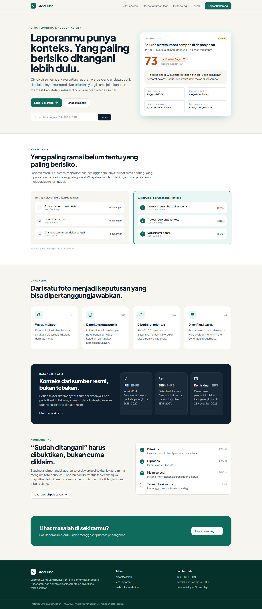

<div align="center">

# 🛰️ CivicPulse: Lapor Berkonteks

**Setiap laporan warga punya konteks, prioritas yang bisa dijelaskan, dan bukti penyelesaian dari warga sendiri.**

Web In Action, MIA 2026 · Tema *Designing Digital Futures: Powering Public Transparency*
Subtema **Civic Reporting & Accountability**, didukung **Data-Driven Decision Support**

[](https://github.com/PehPulo/civicpulse/actions/workflows/ci.yml)




</div>

---

**CivicPulse** adalah website pelaporan warga (jalan rusak, banjir, drainase tersumbat) yang otomatis memperkaya setiap laporan dengan data publik resmi (risiko bencana BNPB, riwayat kejadian, kemiskinan BPS), lalu memberi **skor prioritas yang bisa dijelaskan**. Laporan baru dinyatakan selesai setelah **diverifikasi warga sekitar**, bukan cukup diklaim instansi. AI (computer vision + LLM) berjalan langsung di browser untuk membantu, bukan memutuskan.

📖 Penjelasan lengkap untuk semua orang: **[docs/TENTANG-PROYEK.md](docs/TENTANG-PROYEK.md)**

---

# 👋 Mulai di Sini

Baru buka repo ini? **Ikuti halaman ini dari atas ke bawah.** Tidak perlu membuka file lain sebelum disuruh.

## Langkah 1: Jalankan aplikasinya (10 menit)

Prasyarat: **Node.js 20+** dan **Git**.

```bash
git clone https://github.com/PehPulo/civicpulse.git
cd civicpulse
npm install
npm run dev          # buka http://localhost:5173
```

Coba 4 hal ini supaya paham produknya:

| # | Buka | Yang dicoba |
| :-: | :-- | :-- |
| 1 | `/lapor` | Buat 1 laporan: kategori → unggah foto apa saja (lihat saran AI) → klik peta → deskripsi → kirim. Lihat skor & alasannya |
| 2 | `/laporan/CP-2026-0417` | Laporan "klaim selesai". Kirim verifikasi (centang **mode demo**) |
| 3 | `/dasbor` | Wilayah Senyap, Perlu Perhatian, klik **Buat ringkasan AI** |
| 4 | `/lapor?contoh=hasil` | Pintasan langsung ke hasil skor |

> Tidak perlu backend, database, atau API key. Aplikasi berjalan penuh di browser (mode lokal).

## Langkah 2: Baca 3 dokumen ini, berurutan (±25 menit)

| Urutan | Dokumen | Kenapa |
| :-: | :-- | :-- |
| 1 | [docs/TENTANG-PROYEK.md](docs/TENTANG-PROYEK.md) | Proyek ini ngapain, masalah, fitur, FAQ juri |
| 2 | [CONTRIBUTING.md](CONTRIBUTING.md) | Siapa pegang apa, cara bikin branch & PR, Definition of Done |
| 3 | [docs/ARCHITECTURE.md](docs/ARCHITECTURE.md) | Gambaran sistem & aturan "kode apa ditulis di mana" |

## Langkah 3: Pilih namamu

| Nama | Peran | Lompat ke |
| :-- | :-- | :-- |
| **Christama Ezra Yudianto** | Project Manager · System Integrator · Software Architect · **AI Engineer & MLOps** · **Frontend Lead** | [🧩 Ezra](#ezra) |
| **Albert Juniawan Pasundan** | **Backend · DevOps** | [🛠️ Albert](#albert) |
| **Yance** | Ketua Tim · **Frontend sisi Instansi (admin)** | [🎨 Yance](#yance) |

<a id="ezra"></a>

### 🧩 Ezra

Pemilik **semua kontrak** (`docs/`), **semua AI** (computer vision, LLM, MLOps), **data publik**, dan **frontend sisi warga/pelapor**. Reviewer semua PR.

| # | Tugas | Kerjakan di |
| :-: | :-- | :-- |
| 1 | Menjaga & menyetujui kontrak | `docs/**` |
| 2 | Aturan bisnis + unit test | `packages/core/**` |
| 3 | Lapisan service & integrasi web ↔ api | `apps/web/src/services/**`, `apps/web/src/hooks/**` |
| 4 | AI: CLIP (computer vision) + Qwen2.5 (LLM) | `apps/web/src/ai/**`, `apps/web/src/components/AI.jsx` |
| 5 | MLOps: registry model, dataset & evaluasi, laporan | `ml/**` ([docs/MLOPS.md](docs/MLOPS.md)) |
| 6 | Data asli IRBI/DIBI/BPS | `data/raw/`, `data/scripts/build.js` ([docs/DATA.md](docs/DATA.md)) |
| 7 | Halaman sisi warga: Dasbor (grafik, peta kesenjangan), Peta, Metodologi, Lacak, Data Terbuka, 404 | `apps/web/src/pages/*.jsx` |
| 8 | Review halaman instansi Yance | PR `yance/*` |
| 9 | Review & merge semua PR, demo end-to-end | GitHub |

<a id="albert"></a>

### 🛠️ Albert

**Peranmu: Backend & DevOps.** Semua aturan sudah ditulis Ezra di `docs/`; tugasmu mengimplementasikannya. **AI, data publik, dan frontend bukan bagianmu**; backend cukup membaca `data/processed/wilayah.json` lewat `@civicpulse/data`.

**Urutan baca**

| # | Baca | Isinya |
| :-: | :-- | :-- |
| 1 | [docs/USERS.md](docs/USERS.md) | Siapa boleh melakukan apa |
| 2 | [docs/DATA-MODEL.md](docs/DATA-MODEL.md) | Bentuk data laporan, verifikasi, dll. |
| 3 | [docs/STATUS.md](docs/STATUS.md) | Alur status & aturan verifikasi |
| 4 | [docs/API.md](docs/API.md) | **Kontrak endpoint: yang paling penting** |
| 5 | [apps/api/README.md](apps/api/README.md) | Struktur folder backend & pola endpoint |
| 6 | `apps/web/src/services/adapters/local.js` | **Contoh perilaku yang benar**. Backend harus sama persis |
| 7 | [docs/DEVOPS.md](docs/DEVOPS.md) | Dibaca saat mengerjakan tugas DevOps |

**Urutan kerja**

| # | Tugas | Kerjakan di | Selesai bila |
| :-: | :-- | :-- | :-- |
| 1 | Supabase + jalankan skema | `apps/api/db/migrations/001_init.sql` | tabel & bucket `foto` ada |
| 2 | Endpoint satu per satu: `GET /laporan` → `GET /laporan/:kode` → `POST /laporan` → `dukungan` → `verifikasi` → `auth` → `status` → `unggah` → `statistik` | `apps/api/src/routes/`, `apps/api/src/repositories/laporan.js`, `apps/api/src/middleware/identitas.js` | `npm test` lulus, tidak ada respons 501 |
| 3 | Deploy 2 proyek Vercel + secrets + proteksi `main` | Vercel & GitHub Settings | preview muncul di setiap PR |
| 4 | Tes kontrak Postman di CI | `docs/postman/` (tambah request), `.github/workflows/ci.yml` | job `kontrak-api` hijau |

**Mulai dari #1 dan #2.** Branch pertamamu: `albert/api-laporan`.
⛔ Jangan edit `packages/core/`, `docs/`, `apps/web/`, `ml/`, dan `data/`. Butuh perubahan? Buka Issue & tag Ezra.

<a id="yance"></a>

### 🎨 Yance

**Peranmu: Frontend sisi Instansi (admin)**, yaitu layar yang dipakai petugas Dinas/BPBD untuk menangani laporan. Ezra mengerjakan sisi warga/pelapor. Ditambah uji di HP dan administrasi lomba. Satu tugas kecil per branch, kerjakan sesuai tenaga.

✅ **Rute sudah didaftarkan Ezra** dan file-filemu sudah ada sebagai kerangka. Kamu **hanya mengedit dua folder**: `apps/web/src/pages/instansi/` dan `apps/web/src/components/instansi/`. Jangan sentuh `App.jsx`, `Navbar`, `services/`, atau halaman warga, jadi kamu dan Ezra bisa paralel tanpa konflik.

Coba sekarang: `npm run dev` → buka `/instansi` → otomatis diarahkan ke `/instansi/masuk`.

**Urutan baca**

| # | Baca | Isinya |
| :-: | :-- | :-- |
| 1 | [docs/FRONTEND.md](docs/FRONTEND.md) | **Aturan menulis halaman** + bagian **Sisi instansi (Yance)** |
| 2 | [apps/web/README.md](apps/web/README.md) | Struktur folder frontend |
| 3 | `apps/web/src/pages/Dasbor.jsx` | **Contoh halaman yang benar** (tiru polanya) |
| 4 | [docs/STATUS.md](docs/STATUS.md) · [docs/USERS.md](docs/USERS.md) | Alur status & apa yang boleh dilakukan petugas |

**Urutan kerja**

| # | Tugas | Kerjakan di | Branch | Selesai bila |
| :-: | :-- | :-- | :-- | :-- |
| 1 | **Masuk Instansi** (pemanasan) | `pages/instansi/Masuk.jsx` | `yance/web-instansi-masuk` | PIN `2026` bisa masuk, PIN salah muncul pesan galat |
| 2 | **Layout Instansi** | `components/instansi/LayoutInstansi.jsx` | `yance/web-instansi-layout` | menu Antrean/Kinerja, nama petugas, Keluar, Reset demo |
| 3 | **Antrean** | `pages/instansi/Antrean.jsx` | `yance/web-instansi-antrean` | urut skor tertinggi, filter status/kategori/wilayah, klik → tindak lanjut |
| 4 | **Tindak Lanjut** | `pages/instansi/TindakLanjut.jsx` | `yance/web-instansi-tindak` | ubah status + tanggapan publik, tombol dari `transisiBerikutnya` |
| 5 | **Kinerja Instansi** | `pages/instansi/Kinerja.jsx` | `yance/web-instansi-kinerja` | median hari tangani, dibuka ulang, tabel per wilayah |
| 6 | Uji semua halaman di HP | GitHub Issues → "Laporan bug" | — | bug tercatat |
| 7 | Surat orisinalitas bermeterai | — | — | siap diunggah |

**Mulai dari #1** (paling kecil, untuk kenalan dengan alurnya). Branch pertamamu: `yance/web-instansi-masuk`. Tugas #2–#5 ada di file berbeda, urutannya bebas.
⛔ Jangan `fetch`/`localStorage` langsung di halaman. Ambil data **hanya** lewat `api` (`services/api.js`) + `useApi` (`hooks/useApi.js`).

## Langkah 4: Cara mengirim pekerjaan

```bash
git switch main && git pull                 # selalu mulai dari main terbaru
git switch -c albert/api-laporan            # pola: <nama>/<area>-<tugas>
# ... kerjakan ...
npm run ci                                  # wajib lulus sebelum push
git add . && git commit -m "feat(api): implementasi GET /laporan"
git push -u origin albert/api-laporan
```

Lalu di GitHub: **Compare & pull request** → isi template → reviewer **Ezra**.

## Bingung?

| Pertanyaan | Lihat |
| :-- | :-- |
| "Fitur X kodenya di file mana?" | [Peta cepat](#peta-cepat) di bawah |
| "Endpoint ini harus membalas apa?" | [docs/API.md](docs/API.md) atau perilaku di `adapters/local.js` |
| "Istilah ini artinya apa?" | [Kamus di TENTANG-PROYEK](docs/TENTANG-PROYEK.md#15-kamus-istilah) |
| Masih bingung | Tanya **Ezra** di grup atau buka GitHub Issue |

---

# 📦 Tentang Proyek

## ✨ Progres Saat Ini

| Fitur | Status |
| :-- | :-: |
| Lapor 3 langkah (kategori → foto & lokasi di peta → deskripsi), deteksi kecamatan | ✅ |
| Skor prioritas 0–100 + kalimat alasan + rincian faktor | ✅ |
| Linimasa status publik (Diterima → Diproses → Klaim → Terverifikasi / Dibuka Ulang) | ✅ |
| +1 "saya juga mengalami" (skor dihitung ulang) | ✅ |
| Verifikasi warga: radius 200 m, setelah klaim, 1×/perangkat, otomatis terverifikasi/dibuka ulang | ✅ |
| AI computer vision (CLIP di browser): saran kategori dari foto & cek foto verifikasi | ✅ |
| AI LLM (Qwen2.5 di browser): ringkasan dasbor dengan pengaman anti-halusinasi | ✅ |
| Dasbor akuntabilitas: KPI, Perlu Perhatian, Wilayah Senyap | ✅ |
| Mode lokal offline dengan 38 laporan demo | ✅ |
| Sisi warga: Peta · Metodologi · Lacak · Data Terbuka · 404 · grafik dasbor (Ezra) | 🔜 |
| Sisi instansi: Masuk · Antrean · Tindak Lanjut · Kinerja (Yance) | 🔜 |
| Backend Hono + Supabase · data asli IRBI/DIBI/BPS · evaluasi model | 🔜 |

## 🛠️ Tech Stack

| Bagian | Teknologi |
| :-- | :-- |
| Frontend | React 18, Vite 5, Tailwind CSS 3, React Router 6, Leaflet + OpenStreetMap, Lucide |
| Aturan bisnis | `packages/core` (JavaScript murni, dipakai web & api) |
| Backend | Hono di Vercel Functions, Supabase (Postgres + Storage) |
| AI | Transformers.js di Web Worker: CLIP (computer vision), Qwen2.5-0.5B-Instruct (LLM), WebGPU/WASM |
| Kualitas | ESLint, Prettier, Vitest, GitHub Actions CI, Postman CLI (tes kontrak) |
| Data publik | IRBI & DIBI (BNPB), persentase penduduk miskin (BPS) |

## 🏗️ Arsitektur

```
apps/web (React)  ─►  services/api.js  ─┬─►  adapter lokal (localStorage, offline)
      │                                 └─►  adapter HTTP  ─►  apps/api (Hono)  ─►  Supabase
      └─ ai/ (Web Worker: CLIP + Qwen)  ◄── ml/models.json
                 keduanya memakai: packages/core (skor · status · verifikasi · analitik)
                                   data/processed (IRBI · DIBI · BPS)
```

Detail: [docs/ARCHITECTURE.md](docs/ARCHITECTURE.md). Semua kontrak ada di [`docs/`](docs/).

## 🧰 Perintah

| Perintah | Fungsi |
| :-- | :-- |
| `npm run dev` | web di http://localhost:5173 (mode lokal) |
| `npm run dev:api` | API lokal di http://localhost:8787/api/v1 |
| `npm test` | unit test (core, web, api) |
| `npm run ci` | lint + format + validasi data + tes + build |
| `npm run build && npm run preview` | build produksi / cadangan demo offline |

Mode server: salin `.env.example` ke `.env`, isi `VITE_API_URL`.

## 📁 Struktur Repository

```
.
├── apps/
│   ├── web/            Frontend React + AI di browser            → Ezra (warga), Yance (instansi)
│   └── api/            Backend Hono + migrasi SQL                → Albert        (README di dalam)
├── packages/core/      Aturan bisnis bersama + unit test         → Ezra          (README di dalam)
├── data/               raw → scripts → processed (dataset)       → Ezra          (README di dalam)
├── ml/                 Registry model, dataset & laporan evaluasi → Ezra          (README di dalam)
├── docs/               Semua kontrak + ADR                        → Ezra
├── submission/         Berkas lomba (PDF, PPT, screenshot)
└── .github/            CI, template PR & issue                    → Albert (CI), Ezra (template)
```

<a id="peta-cepat"></a>

### 🗺️ Peta cepat: "fitur X ada di mana?"

| Kalau mau mengubah… | Buka file |
| :-- | :-- |
| Rumus skor / bobot / ambang | `packages/core/src/prioritas.js` (+ `docs/SCORING.md`, naikkan `VERSI_RUMUS`) |
| Alur status / aturan verifikasi | `packages/core/src/status.js`, `verifikasi.js` (+ `docs/STATUS.md`) |
| KPI dasbor, Wilayah Senyap | `packages/core/src/analitik.js` |
| Cara data disimpan/diambil di web | `apps/web/src/services/api.js` → `adapters/local.js` / `adapters/http.js` |
| Laporan demo | `apps/web/src/services/seed.js` |
| Model AI / label prompt / prompt LLM | `ml/models.json` |
| Logika AI di browser | `apps/web/src/ai/worker.js`, `ai/index.js`, `ai/ringkasan.js` |
| Endpoint backend | `apps/api/src/routes/` → `repositories/` |
| Angka wilayah (IRBI/DIBI/BPS) | `data/processed/wilayah.json` (dibangun dari `data/raw/` lewat `data/scripts/build.js`) |
| Halaman petugas instansi (admin) | `apps/web/src/pages/instansi/`, `components/instansi/` (Yance) |
| Warna, font, tombol | `apps/web/tailwind.config.js`, `apps/web/src/index.css` |

## 📊 Sumber Data Publik

| Data | Sumber | Dipakai untuk |
| :-- | :-- | :-- |
| Indeks Risiko Bencana Indonesia (IRBI) | BNPB | Faktor risiko wilayah |
| Data dan Informasi Bencana Indonesia (DIBI) | BNPB | Faktor riwayat kejadian |
| Persentase penduduk miskin kab/kota | BPS | Faktor kerentanan sosial |

> ⚠️ Saat ini angka wilayah masih **data ilustrasi** untuk 8 kecamatan di Bandung Raya (ditandai di UI). Pipeline data asli: [docs/DATA.md](docs/DATA.md).

## 📄 Lisensi

[MIT](LICENSE) © 2026 Tim Peh Pulo
