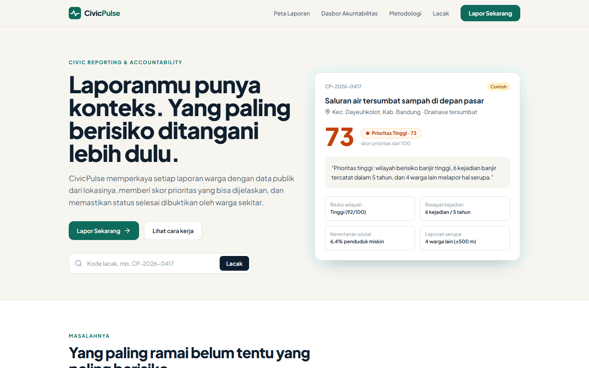

# CivicPulse — Lapor Berkonteks

CivicPulse adalah platform pelaporan warga (jalan rusak, banjir, drainase tersumbat) yang otomatis memperkaya setiap laporan dengan data publik lokasinya (risiko bencana, riwayat kejadian, kemiskinan), lalu memberi skor prioritas yang bisa dijelaskan. Laporan baru dinyatakan selesai setelah diverifikasi warga sekitar, bukan hanya oleh klaim instansi.

> Subtema: **Civic Reporting & Accountability** (didukung Data-Driven Decision Support) — Web In Action, MIA 2026.



## Tech Stack

- **React 18 + Vite 5** — kerangka frontend dan build tool
- **Tailwind CSS 3** — styling, responsif mobile-first
- **React Router 6** — navigasi antarhalaman
- **Leaflet + React Leaflet + OpenStreetMap** — peta pemilihan lokasi laporan
- **Lucide React** — ikon
- **Data publik (rencana integrasi):** IRBI & DIBI (BNPB), data kemiskinan kabupaten/kota (BPS)

## Cara Menjalankan

Prasyarat: Node.js 18 atau lebih baru.

```bash
# 1. Clone
git clone https://github.com/PehPulo/civicpulse.git
cd civicpulse/civicpulse

# 2. Install
npm install

# 3. Run (mode development)
npm run dev
# buka http://localhost:5173
```

Build produksi: `npm run build`, lalu `npm run preview`.

## Progress Saat Ini

- [x] **Landing page** — hero, ilustrasi masalah (ramai vs berisiko), cara kerja, sumber data publik, alur akuntabilitas
- [x] **Halaman Lapor** — form 3 langkah (kategori → foto & lokasi di peta → deskripsi), deteksi kecamatan otomatis
- [x] **Hasil skor prioritas** — skor 0–100, kalimat alasan otomatis, dan rincian kontribusi tiap faktor
- [x] **Detail & lacak laporan** — linimasa tindak lanjut, tanggapan instansi, tombol verifikasi warga dan +1
- [x] Responsif desktop & mobile
- [ ] Impor dataset IRBI, DIBI, dan BPS asli (saat ini **data ilustrasi** untuk 8 kecamatan di Bandung Raya)
- [ ] Peta Laporan, Dasbor Akuntabilitas, dan halaman Metodologi
- [ ] Backend, login tautan email, dan panel instansi

Demo cepat: buka `/lapor?contoh=hasil` untuk langsung melihat hasil skor, atau `/laporan/CP-2026-0417` untuk contoh pelacakan.

## Rumus Skor Prioritas (draft)

```
Skor = 35% × Risiko wilayah (IRBI)
     + 25% × Riwayat kejadian 5 tahun (DIBI)
     + 20% × Kerentanan sosial / kemiskinan (BPS)
     + 20% × Laporan serupa dalam radius ±500 m / 30 hari

Tinggi ≥ 70 · Sedang 40–69 · Rendah < 40
```

Logika ada di [`src/lib/priority.js`](src/lib/priority.js).

## Struktur Folder

```
src/
├── components/   Navbar, Footer, Logo, komponen skor prioritas
├── data/         kategori, data wilayah (ilustrasi), laporan contoh
├── lib/          perhitungan skor prioritas + kalimat alasan
└── pages/        Landing, Lapor, DetailLaporan, SegeraHadir
```

## Tim

| Nama | Peran |
| --- | --- |
| Christama Ezra Yudianto | UI/UX & Konten |
| Albert Juniawan Pasundan | Backend & Data |
| Yance | Ketua, Frontend |
